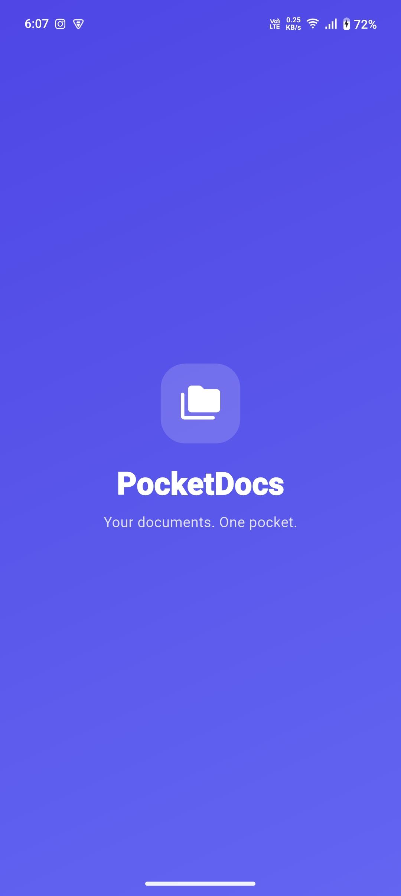
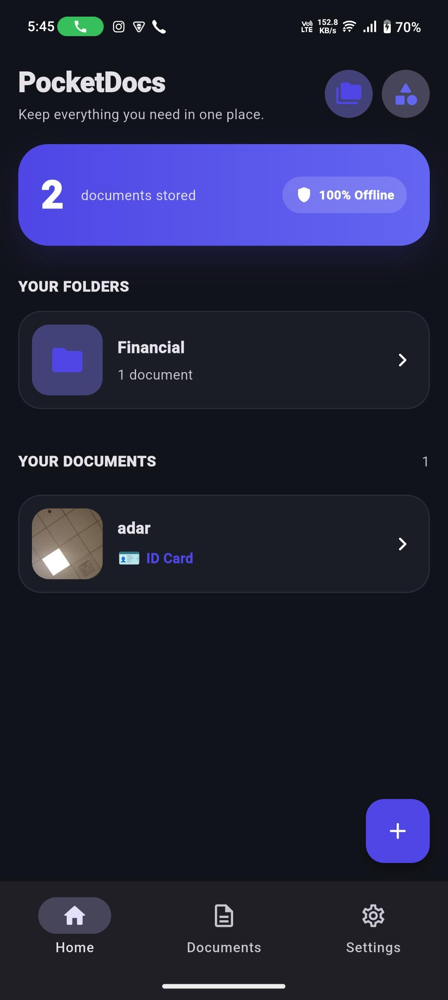
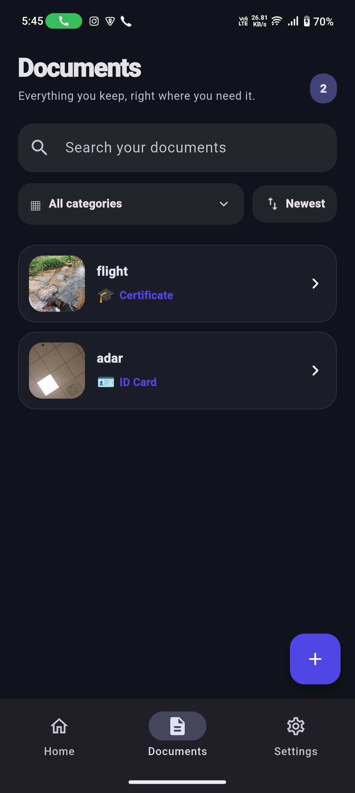
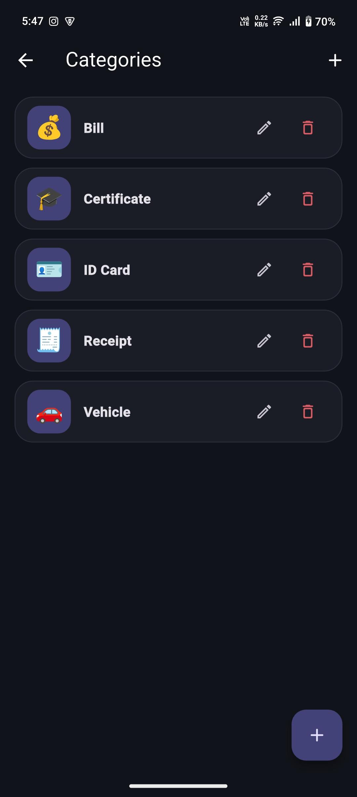
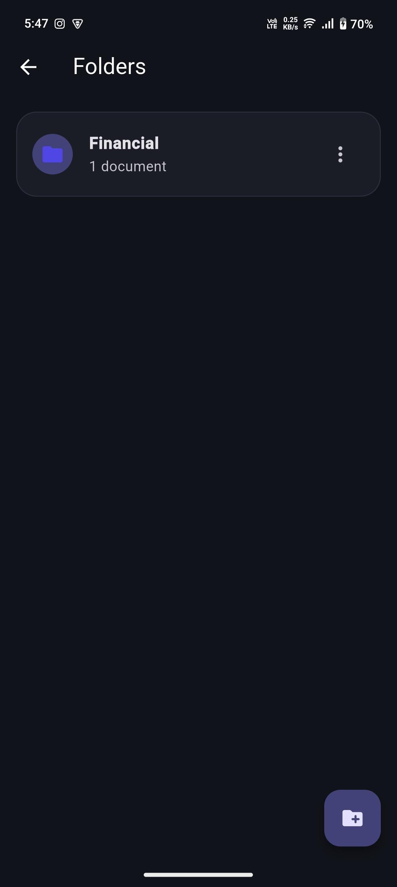
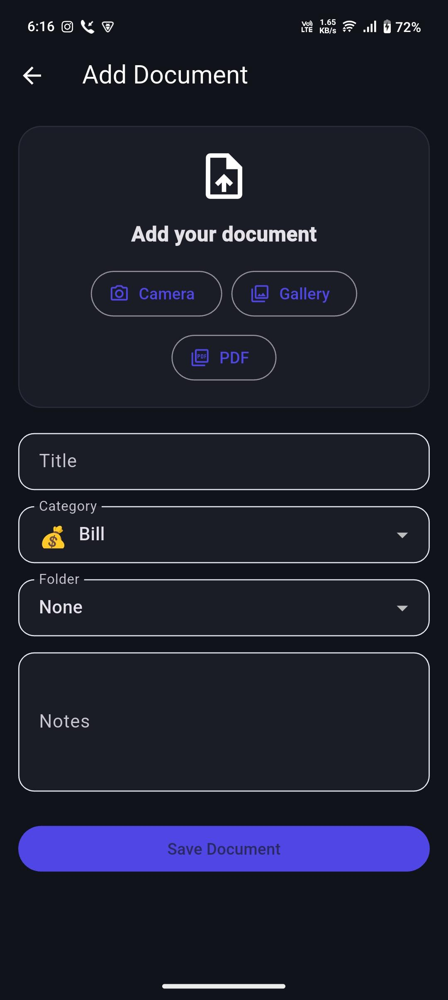
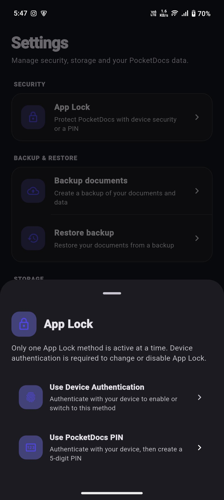
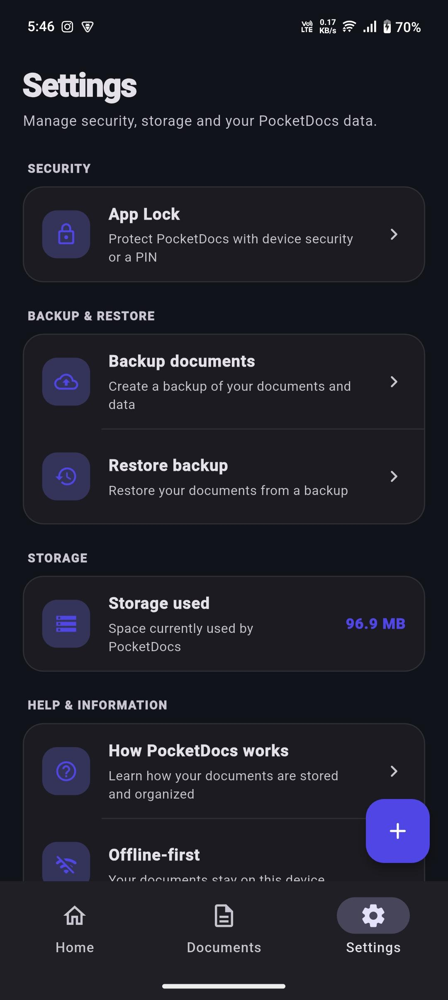

# 📂 PocketDocs – Your Personal Document Vault

PocketDocs is a Flutter-based, local-first document management application designed to help users securely organize, store, search, and manage their important documents in one place.

The application allows users to manage digital copies of receipts, identity cards, certificates, and other important documents while keeping their data stored locally on their devices.

## ✨ Features

- **Document Management:** Add, view, edit, share, download, and delete documents.
- **Category Management:** Organize documents using customizable categories.
- **Folder Management:** Create folders and organize existing documents.
- **Search & Filter:** Quickly find documents using search and category filters.
- **App Lock:** Protect access using PIN-based authentication and device authentication.
- **Encrypted Database:** Secure locally stored application data.
- **Backup & Restore:** Create encrypted backups and restore documents when needed.
- **Image Compression:** Optimize document images to reduce storage usage.
- **Storage Management:** Monitor application storage and manage stored files.
- **Local-First Approach:** Access stored documents without depending on a cloud service.

## 🛠️ Technology Stack

| Technology | Purpose |
|---|---|
| Flutter | Cross-platform UI development |
| Dart | Application programming language |
| Provider | State management |
| SQLite (sqflite) | Local database |
| SharedPreferences | Local preferences |
| File Picker | File selection |
| Local File Storage | Document image management |
| Cryptographic Services | Data and backup encryption |
| Service Locator | Dependency management |

## 🏗️ Architecture

PocketDocs follows a layered, Clean Architecture-inspired structure to separate application responsibilities and improve maintainability.

**Presentation Layer**
- Flutter UI and screens
- Provider-based state management
- ChangeNotifier for managing UI state

**Domain Layer**
- Business entities
- Repository contracts
- Application business rules

**Data Layer**
- Repository implementations
- Local database operations
- Data models
- File and persistence services

**Service Layer**
- Database management
- Encryption
- Backup and restore
- Image compression
- File management
- Dependency registration

## 🔐 Security & Data Management

- PIN-based application access.
- Device authentication support.
- PIN hashing using SHA-256.
- Encrypted local database.
- Encrypted backup and restore functionality.
- Local document storage.


## 📱 Screenshots

### App Introduction
<p align="center">
  
</p>

### Main Experience
<p align="center">
  
  
</p>

### Document Organization
<p align="center">
  
  
  
</p>

### Security & Settings
<p align="center">
  
  
</p>

## 🚀 Getting Started

### Prerequisites

- Flutter SDK
- Dart SDK
- Android Studio or VS Code
- Android or iOS development environment

### Installation

1. Clone the repository:

   ```bash
   git clone https://github.com/subina-khader/pocketdocs.git
   ```
   
2. Navigate to the project directory:

   ```bash
   cd pocketdocs
   ```

3. Install dependencies:

   ```bash
   flutter pub get
   ```

4. Run the application:

   ```bash
   flutter run
   ```

## 🎯 Project Highlights

Through PocketDocs, I explored and implemented:

- Layered application architecture.
- Provider-based state management.
- Dependency injection using a service locator.
- SQLite database integration.
- Repository pattern.
- Local file management.
- Encryption and secure backup mechanisms.
- Image compression and storage optimization.
- Separation of UI, business logic, and data operations.

## 👩‍💻 Developer

**Flutter Developer**

PocketDocs is a personal project developed to strengthen my practical understanding of Flutter application development, software architecture, local persistence, and application security.

---

*Built with Flutter and Dart ❤️*
